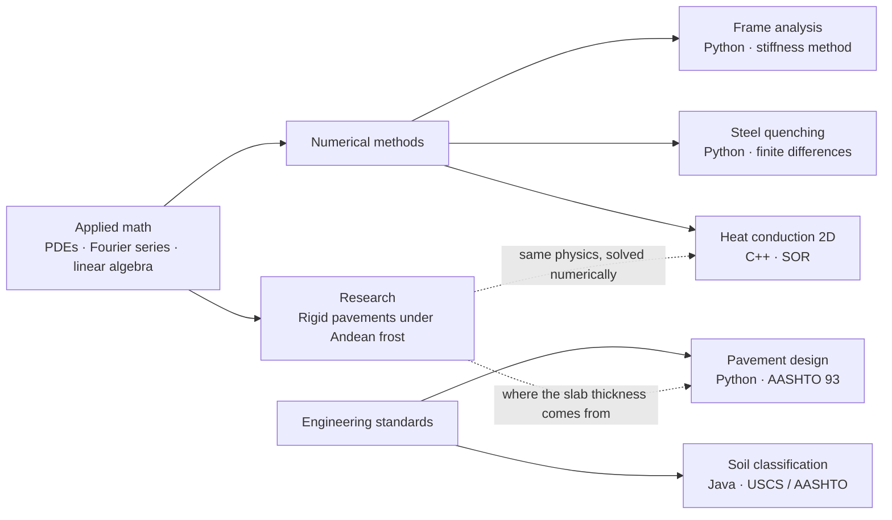
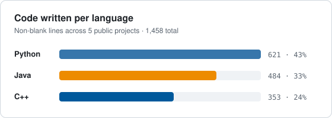

<h1 align="center">Hi, I'm Anthoni Zevallos 👋</h1>
<h3 align="center">Engineering student · Applied math & scientific computing · AI training specialist (STEM & code)</h3>

  
  
  

---

### About me

- 🎓 Studying **Metallurgical Engineering** (UNSAAC) and **Civil Engineering** (UAC) in Cusco, Peru.
- 🔬 Lead researcher of **Clan Bernoulli**, a student research circle in applied mathematics, physics and data analysis.
- 🤖 Freelance **AI training specialist**: I author verified STEM and coding tasks and evaluate LLM reasoning and code.
- 🧮 I like turning engineering problems into equations, then into tested code.

### 🔬 Research

**[pavimento-fourier-heladas-cusco](https://github.com/261893-web/pavimento-fourier-heladas-cusco)**
Analytical Fourier-series model of temperature and thermal stresses in rigid pavements under high-altitude Andean frost, validated with hourly NASA POWER data.
*Manuscript under review at the International Journal of Pavement Research and Technology (Springer).*

### 🛠️ Projects

| Project | What it does | Methods | Language |
|---|---|---|---|
| [analisis-matricial-porticos](https://github.com/261893-web/analisis-matricial-porticos) | Solves 2D frames: displacements, reactions, deflected shape and bending-moment diagrams | Direct stiffness method, matrix algebra, closed-form validation |  |
| [diseno-pavimento-rigido-aashto93](https://github.com/261893-web/diseno-pavimento-rigido-aashto93) | Computes concrete slab thickness and which parameters drive the design | AASHTO 93 equation, Brent root finding, sensitivity analysis |  |
| [temple-acero-diferencias-finitas](https://github.com/261893-web/temple-acero-diferencias-finitas) | Simulates quenching of a steel shaft in water, oil or air | Heat PDE in cylindrical coordinates, finite differences, Bessel-series validation |  |
| [conduccion-2d-sor-cpp](https://github.com/261893-web/conduccion-2d-sor-cpp) | Solves 2D steady heat conduction and compares Jacobi, Gauss-Seidel and SOR | Iterative solvers, Fourier-series validation, CMake/CTest |  |
| [clasificacion-suelos-java](https://github.com/261893-web/clasificacion-suelos-java) | Classifies batches of soil tests (USCS and AASHTO) from a CSV file | Object-oriented design, Maven, JUnit 5 |  |

Every project ships with automated tests (`pytest`, CTest or JUnit) that check results against analytical solutions or reference examples.

### 🗺️ How the projects connect

### 🧰 Tech stack

  
  
  
  
  
  
  
  
  
  
  
  
  
  

### 📊 Languages

---

<i>Open to remote work in AI training, LLM evaluation and STEM content.</i>

